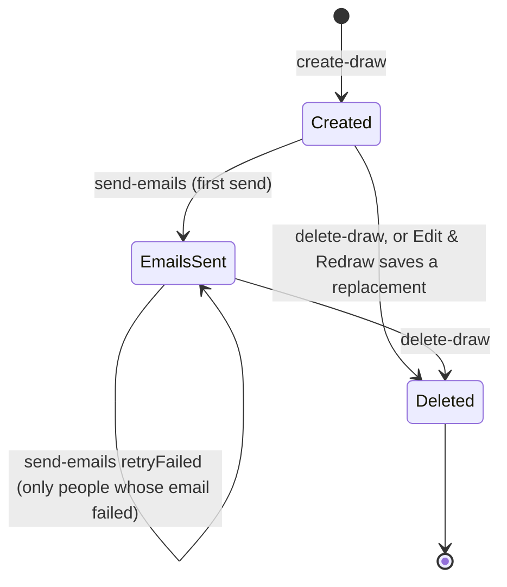

# Architecture

A short tour for someone new to the code. Setup and the API table are in the [README](../README.md); day-to-day operations are in [OPERATIONS.md](OPERATIONS.md).

## Three secrets, three levels of access

There are no accounts. Access comes from three random UUIDs, each carried in a link:

| Secret | Link | Unlocks |
|---|---|---|
| **Draw ID** | `/draw/<id>` (no longer offered for sharing) | Participant names only |
| **Admin key** | `/draw/<id>#key=<adminKey>` (the organizer's link) | Everything about the draw: matches, email addresses, groups, every personal reveal link, per-person email status; sending and resending emails, Edit & Redraw, deleting |
| **Reveal token** | `/reveal/<token>` (one per participant) | That one person's own match, the draw date and, once emails are sent, the organizer's name. Nothing about anyone else |

The admin key is returned once, by `create-draw`, and the organizer is redirected to their link. It travels in the URL fragment, which browsers never send to the server; the draw page reads it there and sends it to `get-draw` in an `X-Admin-Key` header (and in the JSON body to `send-emails` and `delete-draw`), so it never appears in a query string or request log. The organizer page shows the link in a box with a Copy button, marked private; it is never shown to anyone else, so losing it means losing admin access. Older `?key=` links are no longer accepted. Every draw has one (`admin_key` is `NOT NULL`).

## Draw lifecycle



- **Created.** Matches are drawn and saved with the draw. The organizer can share personal links, send emails, Edit & Redraw, or delete.
- **Edit & Redraw** (only before emails go out) copies the participants back into the home page form. The old draw stays live until the new one is saved; `create-draw` then soft-deletes the old draw in the **same transaction** that saves the new one, so there is never a moment with neither or both.
- **Emails sent.** Before anything goes out, one transaction checks the email cap in `EmailSendLog` (495 in any 24 hours, across all draws; `503` if it doesn't fit), on the first send records the organizer's name and email and sets `Draws.emails_sent_at`, claims each participant (`Participants.email_claimed_at`), and reserves the cap for everyone claimed. Failed emails give their reservation back. When that one email settles, `email_sent_at` is set if it went out, or the claim is released if it failed, so the organizer can resend to just those people. A claim older than 5 minutes is from a request that died mid-send and can be taken again. A second full send is refused (`409`). Redraw is blocked from here on, in the UI and in `create-draw`, because emails can't be taken back.
- **Deleted.** `deleted_at` is set; the rows stay. Every link to the draw, including personal links, then gets `410` / "no longer available".

## Request path

```
Browser
  │  /secret-santa/...   (basePath from src/lib/base-path.json)
  ▼
Vercel (region cle1)
  │
  ├─ src/proxy.ts ── runs on /api/* only
  │     create-draw, send-emails, delete-draw: per-IP hourly limit,
  │     counted in the RateLimits table → 429 when over; fails open on DB error
  │
  ├─ src/pages/api/<route>.ts ── validate input → query → JSON response
  │     send-emails also calls Cloudflare Turnstile (CAPTCHA) and Gmail SMTP
  │
  └─ src/lib/db.ts ── Neon serverless driver: each query is one HTTPS request
        to Neon Postgres (AWS US East 2); multi-step writes use sql.transaction()
```

Pages (`index.tsx`, `draw/[id].tsx`, `reveal/[token].tsx`) are client-rendered React; they call the API routes with `fetch`.

## Tables

```
Draws (id uuid)
  │ 1
  ├──< Participants (draw_id, position 1..n, reveal_token, email_sent_at, email_claimed_at)
  │         ▲ giver_participant_id     ▲ receiver_participant_id
  └──< Matches (draw_id) ──────────────┘

EmailSendLog (hour_start)             — emails sent per hour, all draws
RateLimits (bucket, window_start)     — hits per hashed IP + route per hour
```

- **Draws** — one row per draw: admin key, timestamps (`emails_sent_at`, `deleted_at` double as flags), organizer name/email once emails are sent.
- **Participants** — one row per person: name, optional email, optional group name, position in the draw, their reveal token, when their email went out, and a short-lived claim while it is being sent.
- **Matches** — one row per giver → receiver pair, pointing at two Participants rows. Pairs are linked by position, not by name (create-draw separately refuses names that match ignoring case and spaces, so people can tell who they drew). Each participant appears once as a giver and once as a receiver (`UNIQUE` on both columns).
- **EmailSendLog** and **RateLimits** are counters, not tied to any draw.

The schema, with comments, is [`sql/setup.sql`](../sql/setup.sql).

## What data we keep

| Data | Where | How long |
|---|---|---|
| Participant names, optional emails, group names | Participants | Kept, including after the draw is soft-deleted |
| Who drew whom | Matches | Kept with the draw |
| Organizer name and email | Draws, set on first send | Kept with the draw |
| Admin key, reveal tokens | Draws, Participants | Kept with the draw |
| Hashed IP + route hit counts | RateLimits (SHA-256; raw IPs never stored) | About 2 days, then hard-deleted by `src/proxy.ts` |
| Emails sent per hour | EmailSendLog (a count only) | Kept |

Draws are only ever soft-deleted: deleting hides a draw from every link but keeps the rows. Participant and organizer email addresses are kept too, by decision for now; there is no purge job. Emails themselves are sent through the Gmail account in `GMAIL_USER`, so copies also sit in its Sent folder.
