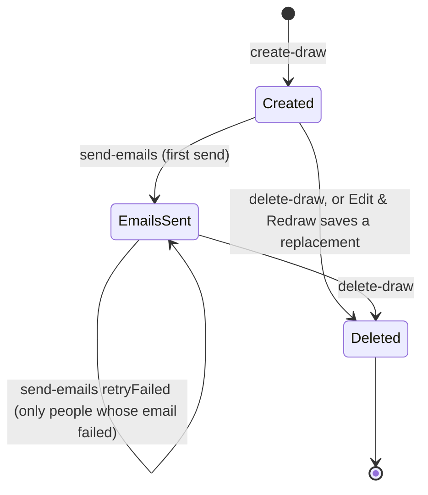

# Architecture

A short tour for someone new to the code. Setup and the API table are in the [README](../README.md); day-to-day operations are in [OPERATIONS.md](OPERATIONS.md).

## Two secrets, two levels of access

There are no accounts. Access comes from two random secrets of letters and digits ([`src/lib/tokens.ts`](../src/lib/tokens.ts)), each carried in a link:

| Secret | Link | Unlocks |
|---|---|---|
| **Admin key** (14 characters) | `/draw#<adminKey>` (the organizer's link) | Everything about the draw: matches, email addresses, groups, every personal reveal link, per-person email status; saving the note, budget and date, sending and resending emails, Edit & Redraw, deleting |
| **Reveal token** (8 characters) | `/reveal/<token>` (one per participant) | That one person's own match, the draw date, the note, budget and exchange date when set, and, once emails are sent, the organizer's name. Nothing about anyone else |

The admin key is returned once, by `create-draw`, and the organizer is redirected to their link. It travels in the URL fragment, which browsers never send to the server; the draw page reads it there and sends it to `get-draw` in an `X-Admin-Key` header, and to `send-emails`, `save-details`, `delete-draw` and (as `replacesKey`, for Edit & Redraw) `create-draw` in the JSON body, so it never appears in a query string or request log. Every route finds the draw by the key alone (`admin_key` is `NOT NULL` and `UNIQUE`), so the draw's own uuid never leaves the server. A key that matches no draw gets `404` from `get-draw` and `403` from the routes that change a draw. The organizer page shows the link in a box with a Copy button, marked private; it is never shown to anyone else, so losing it means losing admin access. A link cut short when pasted gets "This link looks incomplete".

The secrets are short so links fit in a text: the organizer link is about 61 characters and a personal link about 57. 14 characters from 62 are about 83 random bits and 8 about 48, and that length is what keeps guessing out of reach: even with 10,000 personal links live, one guess has about a 1 in 20 billion chance, so a connection at the Firewall's ceiling of 60 requests a minute would expect a hit about once every 700 years, and the prize is one stranger's match. That's why the routes that look a draw up by its secret have no hourly limit of their own in `src/proxy.ts`: the Firewall stops floods, and a counter write on every page view would buy nothing. Personal links get the shorter secret because each shows only one match. Links from before migration 008 (UUIDs, `/draw/<id>#key=…`, `?key=`) no longer open anything.

## Draw lifecycle



- **Created.** Matches are drawn and saved with the draw. The organizer can share personal links, send emails, Edit & Redraw, or delete. When nobody has an email address, sending emails just the organizer their link (one email against the cap) and the draw stays in this state.
- **Edit & Redraw** (only before emails go out) copies the participants back into the home page form. The old draw stays live until the new one is saved; `create-draw` then soft-deletes the old draw in the **same transaction** that saves the new one, so there is never a moment with neither or both. The new draw keeps the old one's saved note, budget and date.
- **Emails sent.** The first send records the organizer's name and email and sets `Draws.emails_sent_at` (how a send works is under [Sending emails](#sending-emails)). A second full send is refused (`409`); only people whose email failed can be sent to again. Redraw is blocked from here on, in the UI and in `create-draw`, because emails can't be taken back.
- **Deleted.** `deleted_at` is set; the rows stay. Every link to the draw, including personal links, then gets `410` / "no longer available".

## Sending emails

The organizer gives their name and email, passes the Turnstile CAPTCHA and sends. Each participant with an email address gets their match and personal link, and the organizer gets their organizer link; if that one email fails, the send still stands and the page tells them to copy the link instead (a resend doesn't email it again). When no participant has an email address, the same form emails just the organizer their link, and the draw stays unsent.

Before anything goes out, one transaction checks the site's cap in `EmailSendLog` (495 emails in any 24 hours across all draws, to stay within Gmail's rolling limit; `503` if the send doesn't fit) and the sender's budget in `RateLimits` (100 emails in any 24 hours per client, an IPv4 address or IPv6 /64, under its own hashed bucket; `429` if it doesn't fit). The budget is skipped for IPs in `RATE_LIMIT_IP_WHITELIST`, and when `RATE_LIMIT_HASH_SECRET` is missing (logged). The same transaction updates the draw (on a first send: the organizer's name and email, the note, budget and date, and `emails_sent_at`), claims each participant (`Participants.email_claimed_at`), and reserves both counts for everyone claimed, plus the organizer's link on a first send. Each person is claimed by only one request, so two clicks can never email anyone twice.

As each email settles, `email_sent_at` is set if it went out; if it failed, the claim is released and its reservation given back. A request that dies midway (the 120-second function limit, or a stalled SMTP connection; SMTP connect, greeting and socket timeouts are 15 seconds) keeps its reservation, since some of those emails may have gone out, and leaves only the emails in flight claimed. A claim older than 5 minutes can be taken again, so those people show as not delivered. The organizer then sees who wasn't reached and can resend to just them (`retryFailed: true`), or share their personal links another way. If every email in a first send fails, the draw is reopened so the organizer can start over. If the request times out (Vercel answers `504` with no JSON body), the page says it couldn't confirm the send and reloads the list, so the organizer sees who was reached before resending.

## Note, budget and date

A card above the email card takes an optional note, a dollar budget and an exchange date. **Save details** (`save-details`) stores them without sending anything, so they show on each personal link page, below the reveal, straight away. The first send also saves whatever is typed and puts them in a box in each match email, above the match; after that they can't be changed (the card shows them read-only and `save-details` answers `409`). While nobody has an email address the draw stays unsent, so they stay editable and are saved each time the organizer link is emailed. Edit & Redraw carries the saved details over to the new draw. A budget of $0 shows as "No limit set".

Once any detail is saved, the saved copy fills the card on load (over the tab's typed draft) and goes into the CSV, PDF and print view; until then those use what is typed. The email card previews a match email with sample names, so it gives no real match away.

## Matching

No participant can draw themselves or anyone in their group. Group names are compared trimmed and case-insensitively, so "Family" and "family " are one group. Before saving, `create-draw` checks feasibility: if any one group holds more than half the participants, no valid assignment exists and the draw is refused (`422`). Matching ([`src/lib/matching.ts`](../src/lib/matching.ts)) then runs in two phases:

1. **Random shuffle**: up to 1,000 attempts pairing givers with a uniformly shuffled receiver list.
2. **Feasibility-checked fallback**: assigns receivers one giver at a time, only taking a receiver that leaves the rest still matchable, so it never dead-ends.

People are matched by their position in the draw, not by name. Names must still differ ignoring case and spaces ([`src/lib/names.ts`](../src/lib/names.ts), checked by the home form and `create-draw`), so each person can tell who they drew.

## Request path

```
Browser
  │  www.baseworkshop.app/secret-santa/...
  ▼
Vercel project baseworkshop-home (owns www.baseworkshop.app)
  │
  ├─ Vercel Firewall ── /secret-santa/api/*: 60 requests a minute per IP → 429,
  │     before any function runs (docs/OPERATIONS.md)
  │
  └─ passes /secret-santa/* on to this app's own .vercel.app address
        │  (basePath /secret-santa, from src/lib/base-path.json)
        ▼
Vercel project secret-santa-app (region cle1)
  │
  ├─ src/proxy.ts ── runs only on create-draw and send-emails (every other route skips it):
  │     per-IP hourly limit, counted in the RateLimits table → 429 when over;
  │     fails open on DB error
  │
  ├─ src/pages/api/<route>.ts ── validate input → query → JSON response
  │     send-emails also calls Cloudflare Turnstile (CAPTCHA) and Gmail SMTP
  │
  └─ src/lib/db.ts ── Neon serverless driver: each query is one HTTPS request
        to Neon Postgres (AWS US East 2); multi-step writes use sql.transaction()
```

Pages (`index.tsx`, `draw.tsx`, `reveal/[token].tsx`) are client-rendered React; they call the API routes with `fetch`.

## Rate limits

[`src/proxy.ts`](../src/proxy.ts) gives each IP an hourly limit on `create-draw` and `send-emails`, the two routes that cost rows or emails (the numbers are in the [API table](../README.md#api-reference)) and answers `429` past it. Counts live in the `RateLimits` table, so every Vercel instance shares them: one row per hashed client and route per hour. A client is an IPv4 address, or an IPv6 /64 block, since one household or phone can hold millions of IPv6 addresses. The hash is HMAC-SHA-256 keyed with `RATE_LIMIT_HASH_SECRET` ([`src/lib/rate-limit.ts`](../src/lib/rate-limit.ts)), so raw IPs are never stored and the hashes can't be reversed without the secret. Rows older than 2 days are deleted on roughly 1 in 100 limited requests. If the database check fails or the secret is missing, the request is let through (fails open) and the error is logged. IPs in `RATE_LIMIT_IP_WHITELIST` are never limited. The Firewall rule in front of it lives in the Vercel dashboard; [OPERATIONS.md](OPERATIONS.md#edge-rate-limit-vercel-firewall) has its settings.

## Monitoring

Each part runs without checking the database more than once a day, to keep Neon's compute asleep between visitors.

- **Server errors** go to Sentry (`src/lib/report.ts`, `src/sentry.server.config.ts`) with no request, URL or user attached. Sentry emails the owner about new issues.
- **Uptime**: a Sentry uptime monitor calls `/api/health` every few minutes. The route never touches the database, so it shows the site and its functions are up; a database outage shows up as real users' errors in Sentry, and as a failed daily job.
- **Daily job**: Vercel Cron calls `/api/ops-check` at 00:00 UTC with `CRON_SECRET`. It writes the previous UTC day's `DailyStats` row, emails the owner when people on sent draws were never emailed or the 24-hour email count nears the cap, and checks in to a Sentry cron monitor, which alerts when a check-in is late or missing. A second cron entry (`?report=weekly`, Sundays 17:00 UTC) emails the week's stats.
- **Visits**: Vercel Web Analytics, loaded by `_app.tsx` from under the base path and proxied to this project's own address by a rewrite in `next.config.js`, since the domain root belongs to baseworkshop-home. Personal links are reported as `/reveal/[code]`, so their secrets never reach the dashboard.

## Tables

```
Draws (id uuid)
  │ 1
  ├──< Participants (draw_id, position 1..n, reveal_code, email_sent_at, email_claimed_at, revealed_at)
  │         ▲ giver_participant_id     ▲ receiver_participant_id
  └──< Matches (draw_id) ──────────────┘

EmailSendLog (hour_start)             — emails sent per hour, all draws
DailyStats (stat_date)                — one row of counts per UTC day, written by the daily check job
RateLimits (bucket, window_start)     — hits per hashed client (IPv4 or IPv6 /64) + route per hour, and emails per hashed client per hour (the 24-hour email budget)
```

- **Draws** — one row per draw: admin key, timestamps (`emails_sent_at`, `deleted_at` double as flags), organizer name/email once emails are sent, and the optional organizer note, budget (in cents) and exchange date.
- **Participants** — one row per person: name, optional email, optional group name, position in the draw, their reveal token, when their email went out, and a short-lived claim while it is being sent.
- **Matches** — one row per giver → receiver pair, pointing at two Participants rows, linked by position rather than name. Each participant appears once as a giver and once as a receiver (`UNIQUE` on both columns).
- **EmailSendLog**, **RateLimits** and **DailyStats** are counters, not tied to any draw. `Participants.revealed_at` is set by `reveal` the first time a personal link shows a match, so the stats can say how many links get opened.

The schema, with comments, is [`sql/setup.sql`](../sql/setup.sql).

## What data we keep

| Data | Where | How long |
|---|---|---|
| Participant names, optional emails, group names | Participants | Kept, including after the draw is soft-deleted |
| Who drew whom | Matches | Kept with the draw |
| Organizer name and email | Draws, set on first send | Kept with the draw |
| Organizer note, budget, exchange date | Draws, set by save-details or the first send | Kept with the draw |
| Admin key, reveal tokens | Draws, Participants | Kept with the draw |
| Hashed IP + route hit counts, and emails per hashed IP | RateLimits (HMAC-SHA-256 with a secret key; raw IPs never stored) | About 2 days, then hard-deleted by `src/proxy.ts` |
| Emails sent per hour | EmailSendLog (a count only) | Kept |
| Draws, participants, emails and first link opens per day | DailyStats (counts only) | Kept |
| Page views (path with personal codes replaced, referrer, country, device) | Vercel Web Analytics | Vercel's retention |
| Server errors | Sentry (stack trace only: the request, URL and user are removed before sending) | Sentry's retention |

Draws are only ever soft-deleted: deleting hides a draw from every link but keeps the rows. Participant and organizer email addresses are kept too, by decision for now; there is no purge job. Emails themselves are sent through the Gmail account in `GMAIL_USER`, so copies also sit in its Sent folder.
